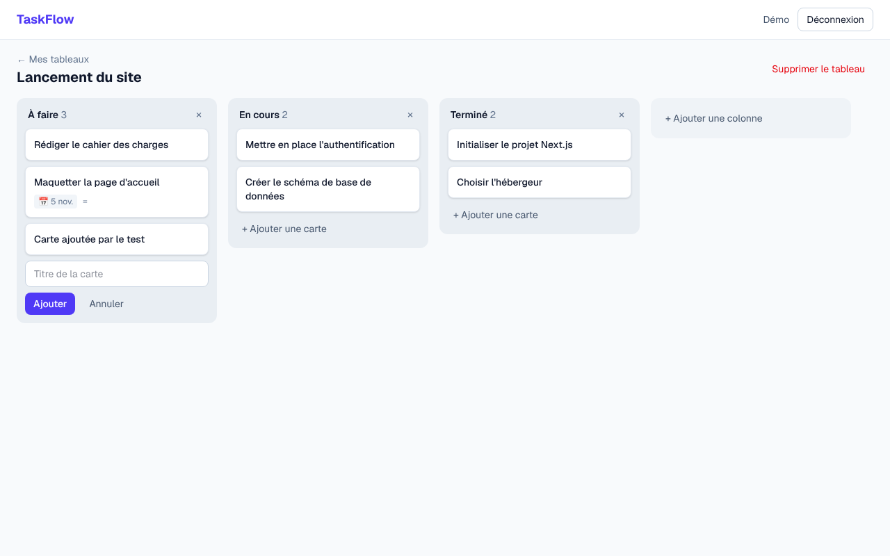

# TaskFlow

Application web de gestion de projets collaborative, inspirée de Trello : des tableaux Kanban où l'on organise ses tâches en colonnes et où on les déplace par glisser-déposer.

**Démo en ligne : [taskflow-qaqx.vercel.app](https://taskflow-qaqx.vercel.app)** (compte de démo : **demo@taskflow.dev** / **demo1234**)

> 🚧 Projet en cours de développement : voir la [feuille de route](#feuille-de-route).



## Fonctionnalités

- **Authentification** : inscription et connexion par email / mot de passe (mots de passe hachés avec bcrypt, sessions JWT)
- **Espaces de travail** : chaque utilisateur a un espace personnel ; les accès sont gérés par rôles (`OWNER`, `ADMIN`, `MEMBER`, `VIEWER`)
- **Invitations** : les propriétaires et administrateurs génèrent un lien d'invitation valable 7 jours, avec le rôle de leur choix ; la personne invitée peut rejoindre l'espace même sans compte (inscription puis retour sur l'invitation)
- **Tableaux Kanban** : création de tableaux, colonnes et cartes
- **Glisser-déposer** des cartes entre colonnes, au clavier comme à la souris, avec mise à jour optimiste de l'interface
- **Détails d'une carte** : description, date d'échéance (mise en évidence quand elle est dépassée)
- **Sécurité** : chaque action serveur vérifie l'appartenance de l'utilisateur à l'espace de travail ; toutes les entrées sont validées avec Zod

## Stack technique

| Couche | Technologies |
|---|---|
| Framework | [Next.js 15](https://nextjs.org) (App Router, Server Components, Server Actions), JavaScript |
| Interface | React 19, Tailwind CSS 4, [dnd-kit](https://dndkit.com) |
| Base de données | PostgreSQL, [Prisma](https://www.prisma.io) |
| Authentification | [Auth.js](https://authjs.dev) (NextAuth v5) |
| Validation | [Zod](https://zod.dev) |
| Qualité | Vitest, ESLint, GitHub Actions |

## Architecture

```
src/
├── app/
│   ├── (auth)/            # Connexion, inscription et page d'invitation
│   ├── (app)/             # Pages protégées : dashboard, tableaux, membres
│   ├── actions/           # Server Actions (mutations : auth, tableaux, colonnes, cartes, invitations)
│   └── api/auth/          # Routes Auth.js
├── components/
│   └── board/             # Kanban : colonnes, cartes, glisser-déposer, modale
├── lib/
│   ├── access.js          # Contrôle d'accès (vérification des rôles)
│   ├── board-utils.js     # Logique pure de réordonnancement (testée)
│   ├── invitations.js     # Statut d'une invitation : valide, expirée, invalide (testé)
│   ├── prisma.js          # Client Prisma
│   ├── roles.js           # Règles de rôles partagées par les pages et les actions
│   ├── safe-redirect.js   # Protection contre les redirections ouvertes après connexion
│   └── validations.js     # Schémas Zod
└── auth.js                # Configuration Auth.js
prisma/
├── schema.prisma          # Modèle de données
└── seed.js                # Données de démonstration
```

**Modèle de données** : `User` ↔ `Membership` (rôle) ↔ `Workspace` → `Board` → `Column` → `Card`, et `Workspace` → `Invitation`

**Choix techniques**

- Les **Server Actions** remplacent une API REST classique : les mutations sont appelées directement depuis les composants, avec validation et contrôle d'accès côté serveur.
- Le glisser-déposer est **optimiste** : l'interface se met à jour immédiatement, puis le serveur réordonne les positions dans une **transaction** ; en cas d'erreur, l'état est restauré.
- La logique de déplacement des cartes est une **fonction pure** (`lib/board-utils.js`), testée unitairement.
- Un lien d'invitation contient un **token aléatoire de 256 bits** : le lien est le seul secret. Le rôle `OWNER` ne peut jamais être attribué par un lien, et cette règle est appliquée côté serveur par le schéma Zod.

## Lancer le projet en local

**Prérequis** : Node.js 20+ et PostgreSQL (ou Docker)

```bash
# 1. Installer les dépendances
npm install

# 2. Configurer l'environnement
cp .env.example .env
# puis générer un secret : npx auth secret

# 3. Démarrer PostgreSQL (si vous utilisez Docker)
docker compose up -d

# 4. Créer les tables et charger les données de démo
npm run db:migrate
npm run db:seed

# 5. Lancer le serveur de développement
npm run dev
```

Ouvrez [http://localhost:3000](http://localhost:3000) et connectez-vous avec le compte de démo : **demo@taskflow.dev** / **demo1234**

## Scripts

| Commande | Description |
|---|---|
| `npm run dev` | Serveur de développement |
| `npm run build` | Build de production |
| `npm test` | Tests unitaires (Vitest) |
| `npm run lint` | Analyse ESLint |
| `npm run db:migrate` | Applique les migrations Prisma |
| `npm run db:seed` | Charge les données de démonstration |

## Feuille de route

- [x] Authentification email / mot de passe
- [x] Espaces de travail et rôles
- [x] Tableaux, colonnes et cartes (CRUD)
- [x] Glisser-déposer des cartes
- [x] Tests unitaires et intégration continue
- [x] Invitation de membres dans un espace de travail
- [ ] Synchronisation en temps réel (Socket.io)
- [ ] Commentaires et assignation des cartes
- [ ] Connexion avec Google
- [ ] Assistant IA : découpage de tâches, création en langage naturel, résumé hebdomadaire
- [x] Déploiement (Vercel + Neon)

## Licence

MIT
